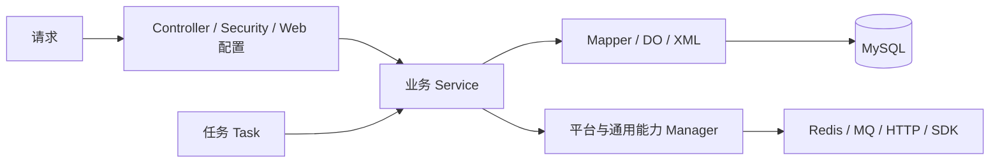

# 架构、模块边界与调用流程

状态：已核查现状与项目约定。维护于 2026-10-13。依赖以各模块 POM 为准，业务行为以源码为准。本页提供任务定位，详细 API/持久化规则分别由对应文档维护。

## 项目结构与依赖边界

这是 Maven 多模块 Java 后端，父工程坐标为 `com.example:demo:1.0`。下列路径均相对于仓库根目录。

| 模块 | 职责与代码入口 | 主要仓库内依赖 |
| --- | --- | --- |
| `demo-api` | `com.example.demo.<业务>.api` 接口、`api.bo` 业务对象，以及 `framework.bo/exception/constant` | 无其他子模块依赖 |
| `demo-dao` | `<业务>.dao.dataobject`、`<业务>.dao.mapper`；SQL 在 `src/main/resources/mappers/` | 无其他子模块依赖 |
| `demo-util` | 通用工具 `com.example.demo.framework.util`；另含第三方来源的验证码、微信加解密代码 | 无其他子模块依赖 |
| `demo-open` | 对外服务契约与 assembly 打包描述；当前 `ICorpService` 为空接口 | `demo-api` |
| `demo-manager` | Redis、HTTP、消息、文件、第三方 SDK、WebSocket/SSE 等通用能力封装 | `demo-dao`、`demo-open`、`demo-util` |
| `demo-service` | 业务编排、权限/数据范围、事务、缓存协调；多数实现继承 MyBatis-Plus `ServiceImpl` | `demo-dao`、`demo-manager`、`demo-open`、`demo-util` |
| `demo-web` | Controller、请求/响应、Spring Security、过滤器、异常处理、Web 配置 | `demo-service` |
| `demo-task` | XXL-JOB 配置与任务 | `demo-service` |
| `start` | Spring Boot 启动及应用配置，生成可执行 JAR | `demo-task`、`demo-web` |

开发时遵循以下边界：

- Web 负责协议适配、参数和访问控制；业务流程放 Service，外部 SDK 细节放 Manager，SQL 放 DAO，共用的无业务工具放 Util。
- API/BO 不依赖 Service、Web 或 DAO 实现；不要引入模块循环依赖。当前部分 API 已使用第三方 SDK 类型，迁移这类契约需单独评估调用兼容性。
- 不因接口名称带 `Service` 就认定实现位于 `demo-service`：Redis、微信、支付等多个接口实际由 Manager 实现。
- 同名实现跨业务包存在，例如多个 `TokenServiceImpl`、`MessageServiceImpl`、`OssServiceImpl`。检查全限定类名、显式 Bean 名、`@Qualifier` / `@Resource`，避免注入歧义。
- 业务主体包括用户/企业/角色/菜单、配置/字典/日志、聊天/订阅、文件，以及微信、钉钉、字节跳动、支付宝、微信支付和云平台集成。
- 不把新功能随意塞入 `framework`。新增抽象应有明确复用需求，优先扩展已有业务包。

### 优先阅读的实现

| 修改类型 | 参考位置 |
| --- | --- |
| 普通 CRUD | `demo-service/src/main/java/com/example/demo/banner/service/BannerServiceImpl.java` |
| 权限、关联批量变更 | `demo-service/src/main/java/com/example/demo/user/service/UserRoleServiceImpl.java`、`role/service/RoleServiceImpl.java`、`role/service/RoleMenuServiceImpl.java` |
| 动态 SQL 与分页 | `demo-dao/src/main/resources/mappers/DictDataMapper.xml`、`RoleMapper.xml`、`ConfigMapper.xml` |
| 通用查询/持久化字段 | `demo-api/src/main/java/com/example/demo/framework/bo/BaseBO.java`、`demo-dao/src/main/java/com/example/demo/framework/query/BaseQuery.java`、`framework/dataobject/BaseDO.java` |
| Web 契约与安全 | `demo-web/src/main/java/com/example/demo/framework/`，特别是 `web/BaseController.java`、`config/WebSecurityConfig.java`、`config/JsonConfigurer.java`、`handler/BaseExceptionHandler.java` |
| Service 测试设施 | `demo-service/src/test/java/com/example/demo/support/ServiceTestSupport.java`、`TransactionProbe.java` |
| Manager 测试样例 | `demo-manager/src/test/java/com/example/demo/cache/manager/RedisServiceImplTest.java` |
| 事务提交后操作 | `demo-util/src/main/java/com/example/demo/framework/util/TransactionUtil.java` |

参考类提供局部模式，不代表其所有功能均已完整或经过真实数据库验证。

## 常规调用与对象流

图表示主要运行调用，不是每个模块的 Maven 直接依赖图。API 的契约由实现类提供，部分 API 已带 SDK 类型，兼容迁移须同步消费者。Manager 也可直接访问 DAO；接口名带 Service 不代表实现一定在 demo-service。

以 BannerController 为例，list 从请求得到 BO，count/list 将 BO 转 DO 查询，结果转回 BO 后包装响应。save 从可信用户上下文取审计人，Service 保存 DO 后回填 BO ID，Web 返回 ObjectResponse。不能仅依据字段同名假定 BO 与 DO 没有转换语义。

| 对象 | 主要职责 | 修改影响 |
| --- | --- | --- |
| BaseBO 与业务 BO | 请求、业务/API 数据和查询条件 | Web 绑定、消费者、序列化 |
| BaseQuery 与业务 DO | SQL 查询附加条件与持久化映射 | MyBatis 字段、逻辑删除、审计 |
| Response | HTTP 响应包装 | body 结构、null 行为；不自动决定 HTTP status |

[BeanUtil](../demo-util/src/main/java/com/example/demo/framework/util/BeanUtil.java) 的 JSON 转换与 BeanCopier 不可机械互换；[API 文档](api-conventions.md) 记录具体解析和响应边界。

## 认证与校验调用

请求经过 [TokenAuthenticationFilter](../demo-web/src/main/java/com/example/demo/framework/filter/TokenAuthenticationFilter.java)，从 Authorization 查用户、设置 SecurityContext 并刷新 TTL。安全 TokenService 用 JWT ID 关联 Redis 用户与权限状态。WebSecurityConfig 的公开入口、认证规则与方法权限是不同层次，企业/用户范围仍在 Service/SQL 中保障。

自定义 NotNull/NotBlank/NotEmpty 由 [ValidateAspect](../demo-service/src/main/java/com/example/demo/framework/aspectj/ValidateAspect.java) 的 Spring AOP 切点执行。直接 new 与自调用不能假定经过校验；不要把它理解为全系统自动 Bean Validation。[Java 约定](java-conventions.md) 记录其特殊空列表语义。

## 事务、缓存和消息边界

具体 Redis 键、TTL、读写/失效入口，以及 MQ/MQTT 路由、消息结构、重复和重试现状见 [缓存与消息契约](cache-and-messaging.md)。

Service 编排数据库事务，Manager 处理外部协议；本地事务不涵盖 Redis、MQ 和 HTTP。[TransactionUtil](../demo-util/src/main/java/com/example/demo/framework/util/TransactionUtil.java) 提供提交后同步回调，无持久化和重试保证。ChatDetail 在事务中写记录并发送消息的现状需要在一致性改动中专项核查，详见 [持久化](persistence.md)。

[RedisConfigurer](../demo-web/src/main/java/com/example/demo/framework/config/RedisConfigurer.java) 设置默认 Fastjson 序列化，不假定 key 是普通字符串字节。认证缓存异常与字典缓存降级不是相同策略。修改 TTL、键或序列化须考虑旧缓存及消费者兼容。

## 装配与部署单元

Start 通过 Web/Task 的依赖装配应用，生成可执行 JAR；Open 的 assembly 包与应用 JAR 用途不同。完整启动可能初始化平台 SDK、消息组件和任务，不能当作纯单元测试必需步骤。

配置源不仅有 application.yml，还有 Java @Value 和 logback-spring.xml；缺少默认值与空默认值会有不同绑定/初始化失败。具体消费位置与前提见 [配置文档](configuration.md)。

## 变更定位与验证

| 改动 | 追踪顺序 |
| --- | --- |
| CRUD/列表 | API → Controller → Service → BO/DO → Mapper/XML → 测试 |
| 权限/关联 | 可信身份 → 企业范围 → 关联生命周期 → 缓存/令牌刷新 |
| 平台请求/回调 | Controller 原始协议 → Manager/SDK → Service 状态与幂等 |
| 公共对象/基础工具 | 全部消费者 → 序列化/类型语义 → 全模块编译 |
| POM/基础设施 | 模块依赖 → JVM/版本 → 测试 → Bean 装配前提 |

模块缺口与待建设能力见 [工程现状](engineering-roadmap.md)。复杂调整使用 [执行计划](../PLANS.md)，长期取舍记录 ADR；类存在或 mock 测试通过不代表业务和真实集成已可用。
