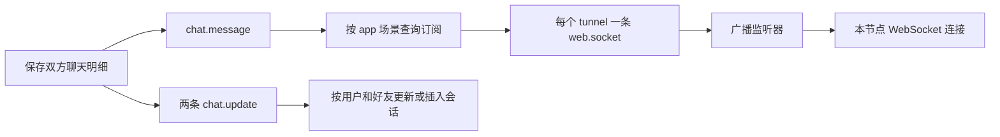

# 缓存与消息契约

维护于 2026-10-18。本文依据仓库中的常量、调用方、消费者和测试整理，不连接 Redis、MQ 或外部平台；不核查 YAML 的配置值。文中的键是 Java 逻辑键，topic/tag 是代码声明，不能据此断言对应资源已在实际环境创建。

配置键及消费者见 [配置说明](configuration.md)，权限与敏感数据约束见 [安全规则](security.md)，数据库事务边界见 [持久化规则](persistence.md)，测试方法见 [测试指南](testing.md)。本文集中维护缓存和消息的具体契约，新增功能时同步更新。

## 1. Redis 基础行为

事实入口：[RedisService 常量](../demo-api/src/main/java/com/example/demo/cache/api/RedisService.java)、[RedisServiceImpl](../demo-manager/src/main/java/com/example/demo/cache/manager/RedisServiceImpl.java)、[RedisConfigurer](../demo-web/src/main/java/com/example/demo/framework/config/RedisConfigurer.java)。

| 操作 | 当前行为 |
| --- | --- |
| add | setIfAbsent，只有成功新增才返回传入值；键已存在、返回 null 或底层异常均转换为 ServiceException |
| set | 覆盖值并设置 TTL，成功返回传入值；底层异常转换为 ServiceException |
| 默认 TTL | add/set 未传有效期时为 86400 秒（24 小时） |
| 显式 timeout | 单位为秒，转换为 Duration.ofSeconds；没有应用层正数校验 |
| Date expiry | null 使用默认 TTL；否则按当前时间到 expiry 的整秒差转换，没有自动修正过期时间 |
| get | 缺失返回 null；底层异常转换为 ServiceException，二者不同 |
| remove | 删除键，不检查删除数量；底层异常转换为 ServiceException |
| hasKey | 存在返回 true；不存在、null 返回值及底层异常均返回 false |
| expire | 重设为默认 24 小时，不保留原 TTL；失败或键不存在时抛 ServiceException |
| replace 三个重载 | 当前均返回 null，尚未实现，不视为可用的原子替换接口 |

RedisTemplate 只设置 GenericFastJsonRedisSerializer 为默认序列化器，没有单独设置 StringRedisSerializer。不能假定本文逻辑键在 Redis 中就是普通字符串字节，也不能直接照抄逻辑键运行删除命令。序列化器或对象类型变更需要兼容旧数据；本项目没有统一缓存版本迁移机制。

## 2. Redis 键清单

花括号内容表示运行期参数，不是真实值。除明确使用 add 的项目外，缓存回填使用 set。TTL 表达式来自源码，不代表平台固定有效期。

| 逻辑键格式 | 值与用途 | TTL | 读写方与失效 |
| --- | --- | --- | --- |
| `key_captcha@{uuid}` | 验证码答案字符串 | 60 秒 | CaptchaServiceImpl.getCaptcha 新增；validate 读取后先尝试删除，再判断答案是否过期或正确 |
| `{uuid}`，无业务前缀 | UserDetails，认证会话；JWT 的 jti 保存此 UUID | 24 小时；refresh 重设 24 小时 | security.TokenServiceImpl.setUser 新增，getUser 读取/必要时回填；remove 删除或自然过期 |
| `key_refresh_token@{userId}@{refreshToken}` | Boolean.TRUE，用户状态/权限版本的有效标记 | 28800 秒（8 小时） | RefreshTokenServiceImpl.set/validate/remove；UserServiceImpl.refreshToken 修改数据库版本后删除旧标记 |
| `key_dict_type@{id}@{value}` | DictType | 24 小时 | DictTypeServiceImpl.getType(String,String) 读写；更新/删除清除旧值相关的三种键，详见下节 |
| `key_dict_type@{typeValue}&{value}` | DictData，按类型和值读取启用字典项 | 24 小时 | DictDataServiceImpl.getData(String,String) 读写；更新、删除及类型值变更清理关联键 |
| `key_role@{id}` | Role，按 ID 查询的角色缓存 | 24 小时 | RoleServiceImpl.getRole(BigInteger) 读写；更新角色、状态及删除角色时清理 |
| `key_dd_token@{appKey}&{appSecret}` | 钉钉 access token 字符串 | expireIn − 300 秒 | dingtalk.TokenServiceImpl 读写；过期/缺失重新请求平台，未见主动删除入口 |
| `key_tt_token@{appId}&{appSecret}&{grantType}` | 字节跳动 access token 字符串 | expiresIn − 300 秒 | bytedance.TokenServiceImpl 读写；过期/缺失重新请求平台 |
| `key_wx_token@{grantType}&{appId}&{appSecret}` | 微信 access token 字符串 | expiresIn − 300 秒 | weixin.TokenServiceImpl 读写；过期/缺失重新请求平台 |
| `key_wx_ticket@{appId}&{appSecret}` | 微信 JSAPI ticket 字符串 | expiresIn − 300 秒 | weixin.TicketServiceImpl 读写；过期/缺失重新请求平台 |

`CACHE_KEY_DD_TICKET`（key_dd_ticket@）和 `CACHE_KEY_ROLE_ID`（key_role_id@）目前只有常量声明，未发现业务使用方，不将其列为已运行缓存。

平台 token/ticket 键当前包含 appSecret，部分异常日志还会拼接逻辑键。这是现存敏感数据暴露风险，不是推荐命名方案。排障时不得复制真实完整键、JWT 或缓存用户对象；后续调整为不含密钥的应用标识或摘要时，须同时制定旧键过期、兼容和日志脱敏方案。

键格式当前没有统一环境/租户前缀，也没有分隔符转义。DictType 和 DictData 共用前缀，仅靠后缀结构区分；不得在未确认输入约束前声称键空间绝无碰撞。

## 3. 读写、失效与降级

### 3.1 字典和角色

来源：[DictTypeServiceImpl](../demo-service/src/main/java/com/example/demo/dict/service/DictTypeServiceImpl.java)、[DictDataServiceImpl](../demo-service/src/main/java/com/example/demo/dict/service/DictDataServiceImpl.java)、[RoleServiceImpl](../demo-service/src/main/java/com/example/demo/role/service/RoleServiceImpl.java)。

- 先读取缓存，未命中再查数据库；缓存读写异常记录日志，尽量返回数据库结果。没有统一的并发回填锁或防击穿机制。
- DictType 查不到返回 null；DictData 按类型和值查不到返回空 DictData；Role 按 ID 查不到抛出“角色不存在”。这些路径均未缓存缺失结果。
- DictType 的 id/value 后缀使用原始参数字符串拼接，null 形成字面量 `null`。更新/删除清理 `{id}@{旧value}`、`{id}@null`、`null@{旧value}`；空字符串等其他参数形式并未被统一归一化，也没有按前缀扫描清理。
- DictData 普通更新在数据库成功后删除旧 typeValue/value 键；批量类型值更新和删除路径会先尝试删除相关旧键，再执行数据库修改。不能概括为全部“提交后失效”。新增没有额外清理流程。
- Role 更新、状态更新、删除清理 ID 缓存；批量 listRoles(ids) 直接查询数据库，不经过逐个 getRole 的缓存。
- 缓存删除异常被记录后吞掉；数据库成功不保证缓存立即失效。并发读写、事务回滚及旧数据回填仍可能产生短期不一致，当前没有可靠失效重试队列。

### 3.2 认证会话与刷新标记

来源：[安全 TokenServiceImpl](../demo-service/src/main/java/com/example/demo/security/service/TokenServiceImpl.java)、[RefreshTokenServiceImpl](../demo-service/src/main/java/com/example/demo/security/service/RefreshTokenServiceImpl.java)、[UserServiceImpl](../demo-service/src/main/java/com/example/demo/user/service/UserServiceImpl.java)、[TokenAuthenticationFilter](../demo-web/src/main/java/com/example/demo/framework/filter/TokenAuthenticationFilter.java)。

1. setUser 生成 UUID，将用户写入 Redis，设置刷新标记，再签发含 jti 的 JWT。当前签发代码没有设置 JWT exp，不能把 Redis TTL 写成 JWT 自身的到期声明。
2. getUser 验证 JWT 并按 jti 取缓存用户。刷新标记不存在时尝试按用户 ID 重载并检查锁定、启用和过期状态，再回填用户与标记。
3. TokenAuthenticationFilter 在用户有效且当前上下文没有认证时设置认证，并调用 refresh 延长会话 TTL；不是所有请求都无条件续期，也不会同时延长刷新标记。
4. UserRole 的关联变更调用 UserService.refreshToken：修改数据库 refreshToken 版本，再删除旧版本标记。它没有遍历所有 UUID 会话键直接删除用户会话。
5. RefreshTokenService 的写入/删除失败只记录日志；hasKey 的 Redis 异常会表现为 false。主会话 get/set/expire/remove 的异常不统一降级为匿名成功。

当前 UserDetailsServiceImpl.loadUserById 仍返回 null，真实重载链路尚不完整；不能用 TokenService 测试中的 mock 重载结果证明生产刷新可用。角色缓存清除也不等价于所有在线用户的权限立即重新加载。

### 3.3 平台 token 与验证码

平台 token/ticket 服务遇到 Redis 读取异常会继续请求平台，回填失败仍可返回本次取得的结果。TTL 为平台响应减 5 分钟，未见非正 TTL 的保护，也没有统一互斥刷新、后台提前刷新或本地重试循环。平台请求自身的失败继续按各 Manager 契约处理。

验证码采用 add，键重复被视作写入失败。validate 对非空 id/code 读取答案后先调用 remove，再判断答案；读取失败会直接抛出，不执行清理。私有 remove 捕获并记录删除异常，之后仍继续校验，删除失败可能留下可再次使用的验证码。验证码不是通过原子 get-and-delete 消费，不能仅凭当前代码承诺并发校验严格一次成功。

## 4. RocketMQ 生产与消费清单

来源：[MQ ProducerServiceImpl](../demo-manager/src/main/java/com/example/demo/mq/manager/ProducerServiceImpl.java)、[ConsumerClusterListener](../demo-service/src/main/java/com/example/demo/mq/service/ConsumerClusterListener.java)、[ConsumerBroadcastListener](../demo-service/src/main/java/com/example/demo/mq/service/ConsumerBroadcastListener.java)。MQ 与 MQTT 的 ProducerService 是不同接口及 Bean，修改注入时核对全限定名称。

业务发送端当前使用字面量 topic `topic`，由 Manager 拼接 `topic:tag`；keys 设置为 RocketMQHeaders.KEYS。以下 keys 主要用于路由或检索，不是已经实现的去重标识。

| topic / tag | 生产者 | keys | body / 消费者 |
| --- | --- | --- | --- |
| `topic / chat.message` | ChatDetailServiceImpl.insertChatDetail | 接收方 userId 字符串 | 接收方 ChatDetailDO 的 JSON 字节；ConsumerClusterListener 解析为 ChatDetail，转发到 app 场景订阅 |
| `topic / chat.update` | 同上；一次聊天分别发送双方会话更新 | 双方共用的 chatId | Chat 的 JSON 字节；ConsumerClusterListener 调用 ChatService.saveOrUpdate |
| `topic / web.socket` | SubscribeServiceImpl.sendMessage | tunnelId | socket.api.bo.Message 的 JSON 字节；ConsumerBroadcastListener 转交 WebSocketService |
| `topic / login.log.save` | LoginServiceImpl.handle | username | LoginLog JSON 字节；仓库未发现消费该 tag 的监听器，不能声称日志已异步入库 |
| `operate.log.save` | LogAspect 中仅有注释掉的发送语句 | 注释中为 null | 未启用，不能列为现有消息通路 |

ConsumerClusterListener 订阅 `chat.message||chat.update`，未显式改用广播模式；ConsumerBroadcastListener 订阅 `web.socket`，明确使用 BROADCASTING。两者代码均声明 consumerGroup=`consumer-group`、topic=`topic`，均启用消息轨迹。不同消费模式和订阅使用同组的部署兼容性需要专门核实，本文不据注解推断线上已正常运行。

## 5. 消息结构与调用链

来源：[ChatDetailServiceImpl](../demo-service/src/main/java/com/example/demo/chat/service/ChatDetailServiceImpl.java)、[SubscribeServiceImpl](../demo-service/src/main/java/com/example/demo/subscribe/service/SubscribeServiceImpl.java)、[消息包装对象](../demo-api/src/main/java/com/example/demo/socket/api/bo/Message.java)、[WebSocketServiceImpl](../demo-manager/src/main/java/com/example/demo/socket/manager/WebSocketServiceImpl.java)。

| 消息 | 业务字段与解释 |
| --- | --- |
| chat.message | id、chatId、userId、friendId、from、type、content；实际序列化源为 DO，可能包含父类字段，不能将此列表视为完整 JSON schema |
| chat.update | userId、friendId、chatTime、chatDetailId、unread；发送方 unread=0，接收方 unread=1。更新 SQL 将 unread 当增量累加，不是绝对未读值 |
| web.socket | type、content 均为 String；聊天转发时 type=`chat.{friendId}.message`，content 是原聊天 JSON 的字符串，外层序列化后为嵌套 JSON 字符串 |
| login.log.save | username、ip、ipAddr、loginTime、status、errMsg；当前生产者将 ipAddr 设为 null，具体字段是否输出由序列化规则决定 |

没有统一的事件版本、业务幂等键、过期时间或追踪上下文字段。JSON.toJSONBytes 负责生产字节；消费者部分文本转换使用无显式 charset 的 new String(body)。变更字符编码、时间表示、字段名、类型或序列化注解时，需要同时检查发送端、消费端和客户端。

SubscribeService 按每页 20 条遍历 Tunnel，逐条发送 web.socket，没有统一批次确认。WebSocketManager 保存本节点连接；广播后仅持有该 tunnel 的节点有机会发送。找不到连接或连接关闭时直接返回；发送 IOException 被记录后吞掉。客户端实际接收文本为 `message:` 加消息 JSON，不是裸 JSON；当前未见客户端业务确认或离线补发机制。

## 6. 失败、重复与事务现状

| 环节 | 当前失败行为 | 不能据此承诺的能力 |
| --- | --- | --- |
| MQ syncSend | 返回 msgId；异常包装为 RuntimeException | 没有应用层补偿记录，返回 msgId 也不是客户端业务处理确认 |
| MQ 延迟 syncSend | delayTime 传给 syncSendDelayTimeSeconds，单位秒；异常向上抛出 | 当前未找到业务调用，不等于已有定时重试流程 |
| MQ send | 调用 RocketMQTemplate.send；异常记录日志后吞掉，无返回确认 | 调用方正常返回不证明消息发送成功；不是 sendOneway 接口 |
| chat.message / chat.update 消费 | 解析及业务异常未在监听器内捕获，向框架传播 | 是否重投及次数由实际客户端/Broker 策略决定，代码未提供明确重试上限或死信处理 |
| web.socket 消费 | 捕获异常并正常返回；底层 WebSocket 也会吞掉 IOException | 不会通过该异常向框架请求重试，无法保证客户端收到 |
| 登录日志 | 有发送方，未找到消费实现 | 无法证明入库、重试和重复日志处理 |

没有发现这些业务消息的统一应用层去重表、Outbox、消费记录或补偿任务。SDK/Broker 可能具备自身机制，但不能把未核查的默认值写成项目保证。

关键影响：

- ChatDetailService.insertChatDetail 的数据库事务内直接发送消息，没有在此使用 TransactionUtil.afterCommit。消息可能早于事务提交，回滚不能撤回已发消息；send 吞异常也可能造成数据库提交但消息缺失。
- [ChatMapper.updateChat](../demo-dao/src/main/resources/mappers/ChatMapper.xml) 执行 `unread = unread + #{unread}`。重复消费接收方 chat.update 可重复累加未读数；消费者读取 keys 到局部 chatId，但未据此去重。
- 当前未见按 chatId 的顺序发送/消费配置或时间戳新旧比较。乱序更新可能覆盖较新的 chatTime/chatDetailId，不能承诺严格有序。
- chat.message 重投会重新遍历订阅并发送，可能重复推送。分发部分成功后失败没有已投递目标记录。
- 本地数据库事务不能回滚 Redis 或 MQ。即使未来改用 afterCommit，也只解决部分时序问题，不自动获得持久化重试和恰好一次处理。

## 7. MQTT 的独立通路

来源：[MQTT ProducerBean](../demo-manager/src/main/java/com/example/demo/mqtt/manager/ProducerBean.java)、[ConsumerBean](../demo-service/src/main/java/com/example/demo/mqtt/service/ConsumerBean.java)、[ConsumerListener](../demo-service/src/main/java/com/example/demo/mqtt/service/ConsumerListener.java)、[ClientStatusBean](../demo-service/src/main/java/com/example/demo/mqtt/service/ClientStatusBean.java)。

- 使用 Alibaba MQTT Server SDK，与上述 RocketMQ listener 不共用协议；MQTT 没有此处的 RocketMQ tag/keys 契约。
- ProducerService.sendMessage(mqttTopic,payload) 接收调用方 topic 和原始 byte[]，返回 msgId；异常包装为 RuntimeException。当前未发现仓库业务层调用。
- ConsumerBean 从 `aliyun.mqtt.topic` 获取订阅主题；ConsumerListener 按 UTF-8 解码并记录 msgId、properties 和 payload，未实现业务持久化或去重。
- ClientStatusBean 根据 `aliyun.mqtt.groupId` 订阅状态；ClientStatusListener 将通知序列化输出，未更新业务在线状态。
- 连接使用 `aliyun.mqtt.domain/port/instanceId` 和 `aliyun.accessKey.id/secret`；不在本文记录取值。Producer Bean 启停方法为 start/stop；两个 Consumer Bean 在创建时 start，销毁时 stop。
- 代码使用默认 ProducerConfig/ConsumerConfig，未明确配置应用层重试、死信或去重。不能从“SDK 接入存在”推断完整消息业务已实现。完整应用上下文测试可能启动这些连接。

## 8. 修改、验证与维护

| 变更 | 必须同步核对 |
| --- | --- |
| 键格式、TTL、缓存对象 | 读写及删除入口、旧键兼容、序列化、过期边界、异常降级是否改变 |
| 字典/角色更新 | 成功后旧键是否处理、事务回滚与并发回填、删除失败的后果 |
| 认证与权限变更 | 会话键和刷新标记区别、版本更新、真实用户重载、失败不得绕过认证 |
| topic/tag/group | 所有发送端与监听器、部署订阅兼容、旧消息消费和回退顺序 |
| body 字段或 keys | 生产者序列化类型、消费者解析、客户端协议、幂等标识及版本兼容 |
| 重试或补偿 | 重复/乱序/部分成功、业务幂等约束、终止条件、死信处理及观察方式 |

现有测试入口包括 RedisServiceImplTest、CaptchaServiceImplTest、各 Token/TicketServiceImplTest、DictData/DictType/RoleServiceImplTest、MQ ProducerServiceImplTest、ConsumerClusterListenerTest、ConsumerBroadcastListenerTest、SubscribeServiceImplTest 和 ChatDetailServiceImplTest。它们主要验证 mock 交互与业务分支，不证明真实 Redis 字节格式、Broker 订阅和重投、数据库回滚或客户端送达。

隔离集成验证应覆盖序列化及 TTL、实际订阅匹配、异常重投、重复累加、乱序和事务回滚。当前未建设完整验证环境；本次文档编写没有访问真实服务，也没有执行这些验证。排障先记录脱敏业务标识、tag、msgId 与异常类型；实际删除缓存、重投消息或调整平台资源需要明确环境和授权，不复制密钥键或完整消息正文。

未来建议（均未因本文而落地）：分离消费者组、定义事件版本和幂等键、为数据库与消息一致性选择可靠方案、补充可观察的重试/死信处理、规范敏感缓存键和日志。具体取舍通过需求与 ADR 确认，不直接把建议写成当前保证。
